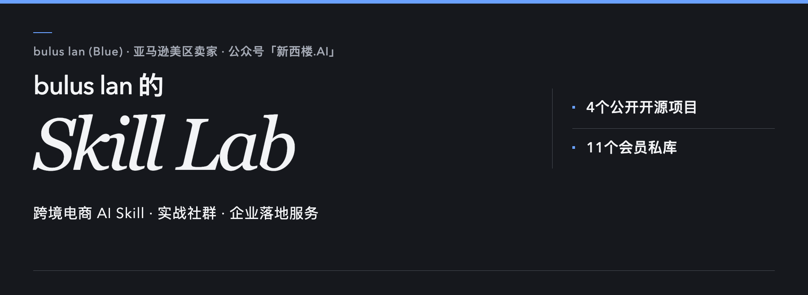
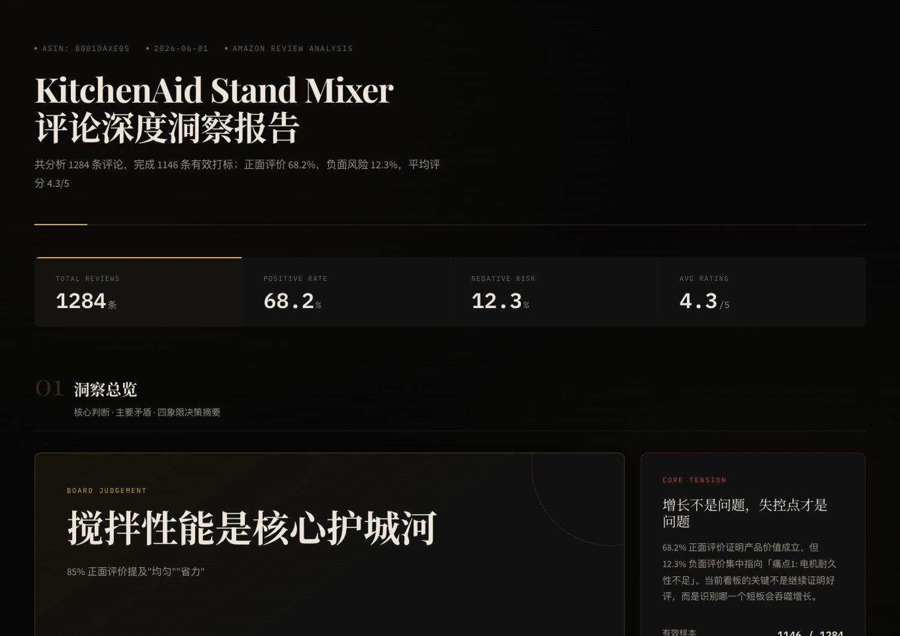
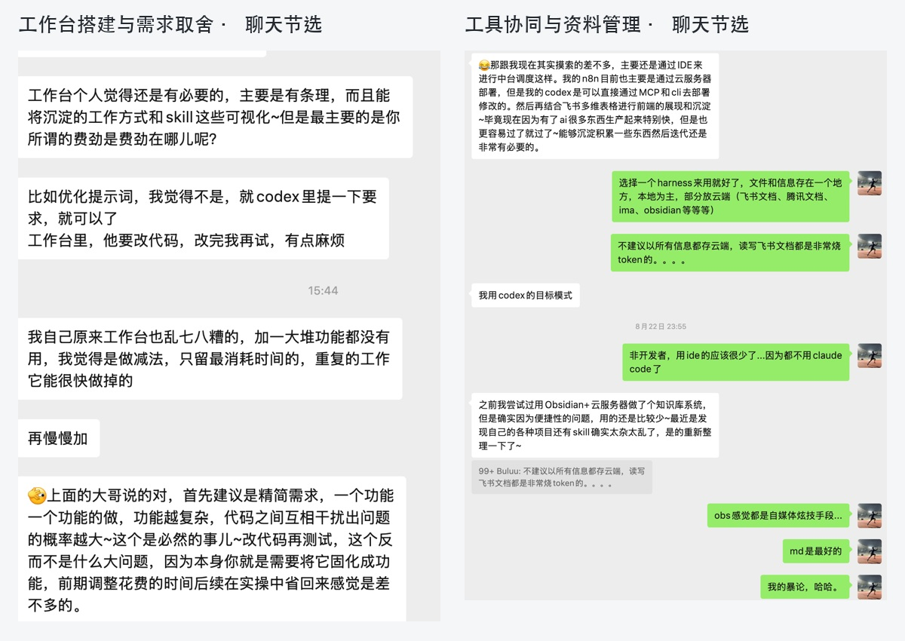
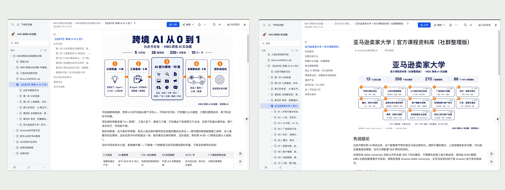
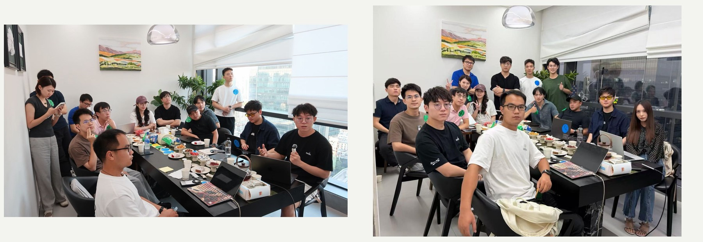
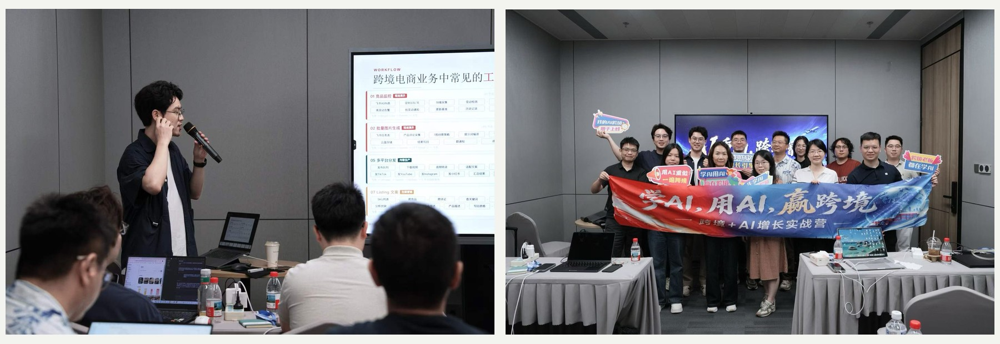

# bulus lan的Skill Lab

从业务一线，到企业AI落地。待过大平台，也在自己做生意。

你好，我是 **bulus lan**（Blue）。曾任职于京东电商、腾讯广告，现在是一名亚马逊美区卖家，也为跨境企业提供 AI 落地咨询与实战内训。同时，我是公众号 **「新西楼.AI」** 的作者，也是 **「MBG 跨境AI实战圈」** 的发起人。

这里汇总我开发维护的 15 个跨境电商 AI Skill。其中 4 个开源项目可直接获取使用；其余 11 个进阶 Skill 面向「MBG 跨境AI实战圈」会员开放。

[个人官网](https://mbgai.vip/) · [了解 MBG 跨境AI实战圈](https://my.feishu.cn/wiki/WNi0wh3mIiOLhzkCLFPcwUr9nrg) · [飞书 Skill Lab](https://my.feishu.cn/wiki/FV87w7QTVi29Qyk3KiIch2kxnxb) · [会员申请 GitHub 权限](https://my.feishu.cn/share/base/shrcnXaPBh0FijhkyHsM5WyE5Se) · [企业合作咨询](https://mbgai.vip/#contact)

## 开箱即用：4 个开源 Skill

以下项目源码公开，无需加入社群即可在支持的 AI Agent 环境中配置使用。

| 项目 | 核心用途与主要输出 | 仓库入口 |
|---|---|---|
| **电商 AI 做图** `gpt-image2-ecommerce` | 按场景生成白底图、场景图、A+ 与卖点图提示词；内置 39 个场景模板与风格预检，输出提示词包或成图。 | [查看仓库](https://github.com/buluslan/gpt-image2-ecommerce) |
| **Listing Doctor** `amazon-listing-doctor` | 检查文案质量、搜索意图与买家问答缺口，输出诊断清单与优化优先级，不直接重写整篇文案。 | [查看仓库](https://github.com/buluslan/amazon-listing-doctor) |
| **Seedance 视频脚本** `seedance-video-script` | 将产品卖点与现有素材整理成分镜脚本和提示词时序，输出分镜指令，不直接渲染视频成品。 | [查看仓库](https://github.com/buluslan/seedance-video-script) |
| **亚马逊运营全流程** `bulus-amazon-skill` | 提供 13 套业务提示词，串联选品体检、趋势验证、竞品拆解、词库、Listing、作图规划、广告体检与日常复盘。 | [查看仓库](https://github.com/buluslan/bulus-amazon-skill) |

## 会员专享：11 个进阶 Skill

以下项目面向实战圈会员开放。入会核验后，可获得对应 GitHub 私有仓库的读取与版本更新权限。

| 业务环节 | Skill 名称与代码 | 核心用途与主要输出 | 获取方式 |
|---|---|---|---|
| **市场与选品** | **选品罗盘** `bulus-amz-product-scout` | 串联市场容量、搜索趋势、细分需求与竞品拆解，输出带数据依据的选品方向。 | [加入实战圈](https://wx.zsxq.com/group/28882111881811) |
| **竞品研究** | **亚马逊竞品狙击手** `amazon-competitor-radar` | 从流量词重叠圈定候选池，按价格带、使用场景、核心卖点筛选真正值得对标的产品。 | [加入实战圈](https://wx.zsxq.com/group/28882111881811) |
| **竞品研究** | **电商竞品分析** `ecommerce-competitor-analyzer` | 从文案、视觉、买家评价与市场位置拆解竞品，梳理差异化切入点。 | [加入实战圈](https://wx.zsxq.com/group/28882111881811) |
| **用户洞察** | **评论 VOC 深度分析** `review-analyzer-skill` | 逐条打标买家真实评论，提炼使用场景、核心诉求与痛点，交付标签数据与看板。 | [加入实战圈](https://wx.zsxq.com/group/28882111881811) |
| **关键词与流量** | **亚马逊关键词策略** `amazon-keyword-strategy` | 从 ASIN 或词表构建词库，区分主攻、截流与否定词，给出匹配与广告结构建议，不改动广告账户。 | [加入实战圈](https://wx.zsxq.com/group/28882111881811) |
| **广告诊断** | **亚马逊广告诊断** `bulus-amazon-ads-doctor` | 核对报表时间、币种与归因，结合 ACOS、产品 TCOS 与经营条件排查异常花费。 | [加入实战圈](https://wx.zsxq.com/group/28882111881811) |
| **内容拓展** | **亚马逊爆品转 TK 探索** `tk-content-fit` | 交叉验证商品需求、视频演示、内容竞争与达人资源，输出内容方向与最小测试计划。 | [加入实战圈](https://wx.zsxq.com/group/28882111881811) |
| **流程自动化** | **n8n Goal Loop** `n8n-goal-loop` | 把自动化需求梳理为包含数据流、容错与验收标准的规范指令，仅输出开发目标。 | [加入实战圈](https://wx.zsxq.com/group/28882111881811) |
| **流程自动化** | **n8n 转 Skill** `n8n-to-skill` | 理解现有 n8n 工作流业务逻辑，重写为可由 Agent 独立实现的专用 Skill。 | [加入实战圈](https://wx.zsxq.com/group/28882111881811) |
| **资产沉淀** | **知识库智能管家** `bulus-wiki-manager` | 把零散的业务资料与 SOP 整理为可检索、有版本记录的知识库，支持增量查验。 | [加入实战圈](https://wx.zsxq.com/group/28882111881811) |
| **智能体治理** | **Skill 体检大师** `bulus-skill-auditor` | 检查提示词过长、规则冲突和冗余问题，给出具体的瘦身和修改建议。 | [加入实战圈](https://wx.zsxq.com/group/28882111881811) |

### 加入 MBG 跨境AI实战圈获取会员权限

加入社群后需经人工核验。管理员核对会员档案后，会向你的 GitHub 账号发送组织邀请，手动接受后即可访问上述私有仓库。

- **加入社群**：[查看飞书详细权益介绍](https://my.feishu.cn/wiki/WNi0wh3mIiOLhzkCLFPcwUr9nrg) · [电脑端访问知识星球](https://wx.zsxq.com/group/28882111881811) · [手机端访问知识星球](https://wx.zsxq.com/mweb/views/topic/topic.html?group_id=28882111881811)
- **已是会员申请权限**：请前往 **[GitHub 权限申请表](https://my.feishu.cn/share/base/shrcnXaPBh0FijhkyHsM5WyE5Se)** 提交账号信息。

<strong>会员权限申请与运行须知（点击展开）</strong>

1. **填写申请**：有效会员前往 **[GitHub 权限申请表](https://my.feishu.cn/share/base/shrcnXaPBh0FijhkyHsM5WyE5Se)** 填写实战圈编号与 GitHub 登录名或主页链接。星球昵称选填；无账号可先前往 [GitHub](https://github.com/signup) 注册。
2. **资格核验**：管理员核对会员档案后处理邀请，非系统自动开通。
3. **接受邀请**：登录 GitHub 确认并接受来自 [mbgai-members](https://github.com/mbgai-members) 组织的邀请，手动接受后权限生效。按各仓库内 `MEMBER-INSTALL.md` 配置使用。使用个人登录凭证即可，切勿向任何人提供密码、短信验证码或个人 Token。
4. **到期与环境边界**：会员到期后，仓库在线访问与后续更新权限中止，此前已下载到本地的文件不会被删除。各 Skill 按项目文档准备运行环境、模型和数据，第三方费用自理，缺少数据输入时不捏造事实。开源项目与第三方引用的已有许可证继续有效，私库交付权限不撤销历史开源许可。

这是评论分析 Skill 生成的公开样例看板：

## 实战圈里，除了 Skill 还有什么

**MBG 跨境AI实战圈** 聚焦跨境电商业务中的 AI 实操应用。除了持续更新自研 Skill，社群还提供日常答疑、实操资料与同行交流：

- **微信交流群与答疑**：专属微信群与知识星球提问，由我直接解答业务疑问。交流内容包括提示词调优、模型适配、自动化工作流搭建与 Agent 编排。

[查看完整聊天：工作台搭建](assets/workbench-discussion.png) · [查看完整聊天：工具协同](assets/workflow-tools-discussion.png)

- **知识星球与飞书知识库**：星球持续发布 AI 行业资讯与新工具动态。飞书知识库系统沉淀实操教程，包括海外模型订阅、Codex 与 Claude Code 部署、电商图片与带货视频生成、Agent 辅助开发 n8n 工作流等；同时归档了《跨境AI从0到1白皮书》、亚马逊卖家大学课程社群整理版以及线下茶话会纪要。完整知识库经会员核验后开通。

- **常用工具采购支持**：对接卖家精灵、达人精灵、SIF 关键词、Sorftime 等工具的采购福利与大模型接入渠道，具体以社群通知为准。
- **线下闭门交流**：组织面对面的业务卡点与实操复盘，深圳场已举办，后续场次看社群通知。

## 企业服务：面向跨境团队的 AI 落地合作

社群主要面向个人卖家与实操者自我提升。当企业需要针对自身业务流程、团队协作或特定需求进行深度改造时，我们提供单独约定的商业服务。各项服务可根据需求独立开展或组合推进。

| 服务方向 | 适用问题 | 工作重点 | 交付方向 |
|---|---|---|---|
| **AI 咨询与组织诊断** | 明确适合优先落地的业务环节 | 现状诊断、场景优先级评估 | AI 升级诊断报告与分步落地规划 |
| **企业级 AI 内训** | 团队缺乏岗位任务规范操作 | 选品、Listing、作图、广告实训共创 | 团队实战操作方法与现场实训成果 |
| **AI 化改造升级陪跑** | 流程推进受阻，需要持续磨合 | 流程试点推进、团队导入辅导 | 试点推进结果与下一阶段优化建议 |
| **定制开发与 FDE** | 现成工具无法满足特有业务逻辑 | 业务需求适配、开发集成与联调 | 专属 AI 工具或业务智能体 |

[在官网查看企业服务详情](https://mbgai.vip/#services) · [预约企业合作沟通](https://mbgai.vip/#contact)

## 持续阅读与合作联系

公众号 **「新西楼.AI」** 持续分享业务实操、AI 实践与商业思考。如需探讨企业内训、咨询或定制开发，欢迎通过官网或微信沟通。

- **个人官网**：[mbgai.vip](https://mbgai.vip/)
- **飞书 Skill Lab**：[查看工具形态与文档](https://my.feishu.cn/wiki/FV87w7QTVi29Qyk3KiIch2kxnxb)
- **GitHub 个人主页**：[github.com/buluslan](https://github.com/buluslan)
- **商务咨询**：[mbgai.vip/#contact](https://mbgai.vip/#contact)

---

本页内容用于说明当前各工具与服务的基本功能与获取途径；具体版本状态、运行依赖与社群安排以对应交付说明与最新通知为准。
